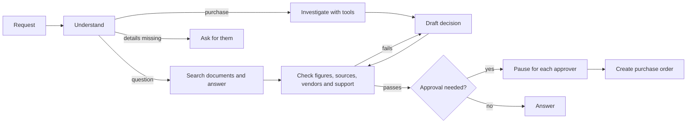
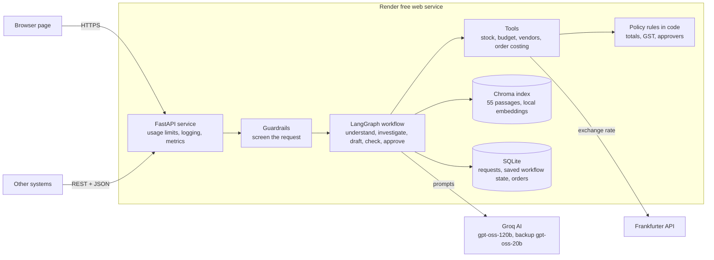

# Quartermaster

An AI procurement assistant that handles purchase requests the way a careful procurement officer would. It
reads a plain-English request, checks company policy, stock, prices and budget, and prepares
an order that the right managers approve before anything is bought. It also answers questions
about company policies, contracts and vendors, always showing where the answer came from.

Built for Project 12: an agentic AI workflow with enterprise knowledge retrieval, tool use,
human approval, hallucination checks, evaluation and a production-ready service.

> Kestrel Works, its policies, vendors and figures are fictional. No real orders are placed.

## The business problem

A request like *"We need 20 laptops for the new Engineering hires in Pune"* takes a
procurement team several steps: check whether stock can cover it, find approved vendors,
compare prices, apply tax and currency rules, check the department budget, and work out who
must sign off. Each step is a chance to miss a rule. An AI can do the legwork quickly, but it
must not be trusted to invent figures, skip a rule or place an order on its own.

## What it does

| You send | You get back |
|---|---|
| A purchase request | Where the items come from (stock, a transfer between offices, or a purchase), the vendor, the total with GST, who must approve, and the policy reasons with sources |
| A question, such as *"How long is the warranty on Lotus Peak laptops?"* | A short answer, with the exact page, row or email it came from |
| Something it cannot do safely | A refusal, or the questions it needs answered first |

An order is created only after every required approver has approved it on the page.

## How it works



1. **Understand:** the AI turns the text into structured details: product, quantity, office,
   department, budget and business reason. Anything missing becomes a question.
2. **Investigate:** the AI chooses which tools to call: document search, stock, vendor offers,
   budget, a live exchange rate and order costing.
3. **Draft:** the AI writes the decision and its reasons, citing the documents.
4. **Check:** code checks every figure, source and vendor against the records, and a second AI
   call checks that each cited passage really supports its statement. A failed check gets one
   correction; a second failure goes to a person marked *needs careful review*.
5. **Approve:** the workflow pauses, saved to disk, until each required approver decides.
   Approvers can approve, reject, or change the vendor or quantity, which restarts approval.

### Architecture



### The AI proposes; code decides

The AI never calculates a figure or picks an approver. Totals, tax, currency conversion,
approval levels and rule breaches all come from code that implements the policies. If the AI
writes a different total, the code's total is used. The AI is never offered the tool that
creates purchase orders, and that tool rechecks every rule and refuses a duplicate.

## Company knowledge

Structured and unstructured documents share one search index, and every passage keeps an
exact citation:

| Document | Type | Cited as |
|---|---|---|
| Six policies: procurement, approvals, vendors, hardware, foreign currency, travel | Markdown, unstructured | `POL-003 section 3.1` |
| Lotus Peak supply agreement | PDF, unstructured | `CON-104 page 2` |
| Laptop refresh memo | Word, unstructured | `MEM-011 paragraph 3` |
| Network switch email thread | Email, unstructured | `EML-022 message 2` |
| Vendor rate card | Spreadsheet, structured | `PRL-Q4 row 18` |
| Vendor register | Database records, structured | `REG-VND record V-106` |

Search returns the three best policy sections plus the three best passages from other documents.
Searching everything together let the laptop memo push the laptop policy out of the results.
The embedding model runs locally, so documents never leave the machine for indexing.

## Results

Measured on the real AI model (`openai/gpt-oss-120b` on Groq, with `openai/gpt-oss-20b` as
backup). The 40 evaluation cases are in `evals/cases.json`: 16 purchases, 18 questions and 6
attempts to misuse the assistant. Purchase answers are worked out from the policy rules in code,
so each one is checked against what the rules require. The full table is in
[`evals/REPORT.md`](evals/REPORT.md), and every saved answer is in `evals/results/`.

- **37 of 40 cases fully correct**, up from 32 of 40 before the fixes the first run pointed to.
  Questions 18/18, purchases 14/16, misuse attempts 5/6.
- **When a purchase went through, it was right:** the vendor, the approvers and the total
  matched the rules every time (10/10, 10/10, 9/9).
- **The 3 misses were stopped, not shipped.** In each one the automatic check found a claim it
  could not back up and sent the request to a person. One example: the AI said docks were for new
  hires when the request never said so.
- **What the first run found and fixed:** citations of company records were rejected, short
  citations like "POL-003 3.1" were not recognised, a vendor code was read as a price, a request
  naming a blocked vendor failed outright, unlisted items used the AI for nothing, and questions
  about lists were not answered.
- **Prompts versus code:** the first prompts were run again on 22 of the cases before the
  free daily AI allowance ran out. They scored 19/22, against 20/22 for the current version. On
  these cases most of the gain came from code changes, not from rewording the prompts.
- **Speed and cost:** a question takes about 3 seconds and 2,400 tokens (median). A purchase
  takes about 23 seconds and 9,000 tokens; the slowest took 91 seconds while waiting on free-tier
  rate limits.
- **Search:** the right passage appears in the results for all 29 test questions.
- **Automated tests:** 266 tests run on every push, with a scripted AI standing in for the model.

## Try it

**Online:** https://quartermaster-a2cb.onrender.com, open to anyone. The first visit after a quiet spell takes about a minute while the free server wakes up.

**On your own computer** (needs [uv](https://docs.astral.sh/uv/) and a free key from
[console.groq.com/keys](https://console.groq.com/keys), no card needed):

```
uv sync
cp .env.example .env          # paste your Groq key into .env
uv run uvicorn procurement_agent.api:app --port 8765
```

Then open http://127.0.0.1:8765/. Set `API_KEY` in `.env` to require an access key.

Calls that use the AI are limited to 5 per visitor every 10 minutes and 100 a day for the
whole service, so an open demo cannot use up the free AI allowance. Change them with
`LIMIT_PER_VISITOR`, `LIMIT_WINDOW_SECONDS` and `LIMIT_PER_DAY`; 0 turns a limit off.

### Using the API directly

Interactive API documentation is at `/docs`. Every call except `/` and `/health` needs the
`X-API-Key` header when an access key is set.

```
curl -X POST http://127.0.0.1:8765/requests \
  -H "X-API-Key: $API_KEY" -H "Content-Type: application/json" \
  -d '{"text": "We need 20 standard laptops for Engineering in Pune"}'

curl -X POST http://127.0.0.1:8765/requests/<id>/decisions \
  -H "X-API-Key: $API_KEY" -H "Content-Type: application/json" \
  -d '{"role": "Department Head", "action": "approve", "name": "A. Manager"}'
```

| Route | Purpose |
|---|---|
| `POST /requests` | Submit a request or question; returns the structured response |
| `GET /requests` | The 50 most recent requests and their status |
| `GET /requests/{id}` | One request in full |
| `POST /requests/{id}/decisions` | Approve, reject or change an order |
| `GET /health` | Database, search index and AI key status, for monitoring |
| `GET /metrics` | Requests by status, median and slowest time, AI tokens used, usage-limit refusals |

## When things go wrong

| Problem | What happens |
|---|---|
| The main AI model is rate limited or down | The backup model (`openai/gpt-oss-20b`, a separate free allowance) answers instead. Short rate limits are waited out for up to 90 seconds |
| Both models are unavailable | The request ends as *Could not complete* with a plain "try again in a minute" message. Nothing is decided or ordered |
| A check fails | The AI gets one correction. A second failure goes to a person as *Needs careful review* |
| A request tries to instruct the AI ("ignore your rules", "skip approval") | It is refused before the AI sees it |
| Text that is not a request | It is refused with an example of what to send |
| A document is broken, over 10 MB, or contains planted instructions | That document or passage is skipped and logged; the rest still load |
| Too many requests | Each visitor gets 5 every 10 minutes and the whole service 100 a day, with a clear message and a `Retry-After` header |

The AI is also told to treat everything it reads as data, and it never sees the tool that
creates purchase orders, so even a request that slipped past the screen could not place an order.

## Known limits

- **One product per request.** "20 laptops and 20 monitors" is not handled as one order yet,
  and the no-splitting rule (POL-002 2.3) is not checked across separate orders.
- **Approver identity is checked only when approver keys are set.** The public demo leaves them
  off, so any visitor can act as any approver. Set `APPROVER_KEYS` (for example
  `Department Head=key1;Finance Controller=key2`) and each role needs its own key.
- **Free-tier limits.** Groq's free plan allows about 1,000 requests and 8,000 tokens a minute,
  so a busy period means waits. Free hosting sleeps when idle and loses saved requests when it restarts.
- **Fictional data.** The rules are realistic, but the company and documents are invented.

## Built with

All free, with no card needed: LangGraph for the workflow and approval pauses, Groq for the AI
model, fastembed and Chroma for local search, FastAPI and SQLite for the service, the
Frankfurter API for live exchange rates, and GitHub Actions for tests.

## Development

```
uv run pytest                              # all tests, no AI key needed
uv run ruff check && uv run ruff format --check
uv run python scripts/check_services.py    # live check of the AI and exchange-rate services
uv run python scripts/run_request.py "20 laptops for Pune engineering"
uv run python scripts/build_documents.py   # rebuild the PDF, Word, Excel and email files
```

### Deploying

The service runs as a Docker container on Render's free plan, which needs no card. In
Render, choose **New > Blueprint**, select this repository, and enter the two values it asks
for: `GROQ_API_KEY`, and optionally `API_KEY` if you want visitors to need an access key
(leave it empty for an open demo). `render.yaml`
holds the rest. Every push to `main` redeploys.

Free instances sleep after 15 minutes without visitors, so the first visit after a quiet spell
takes about a minute.

| Path | Contents |
|---|---|
| `src/procurement_agent/agent.py` | The workflow graph |
| `src/procurement_agent/rules.py` | Policy rules as code: totals, approvers, rule breaches |
| `src/procurement_agent/verify.py` | Hallucination checks |
| `src/procurement_agent/knowledge.py` | Document reading and search |
| `src/procurement_agent/tools.py` | Tools the AI can call |
| `src/procurement_agent/api.py` | The web service |
| `Dockerfile`, `render.yaml` | Container and free deployment on Render |
| `data/` | Policies, documents and company records |
